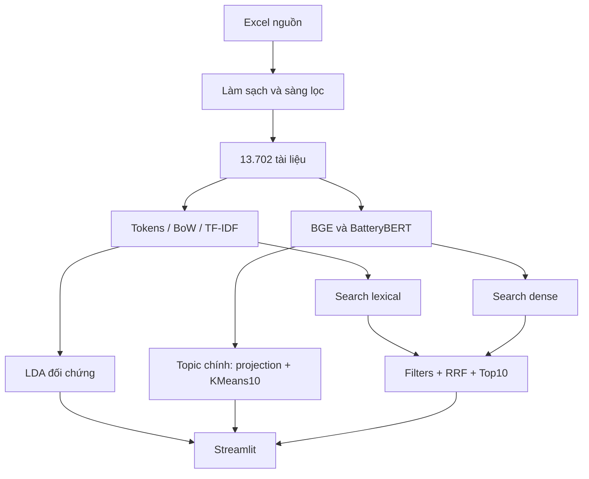

# Báo cáo toàn bộ pipeline chương trình - 24/10/2026

> Snapshot trước lượt neural training full-document ngày 24/10. Xem [báo cáo mới sau huấn luyện](BAO_CAO_PIPELINE_BATTERYBERT_FULLDOC_20261024.md) và [kết quả thực thi mới](BATTERYBERT_FULL_DOCUMENT_RESULTS_20261024.md) để biết cấu hình hiện hành. Giữ nội dung bên dưới làm đối chứng lịch sử.

Sodium-ion Research Explorer

Dữ liệu - Biểu diễn - Topic modeling - Tìm kiếm - Đánh giá

Ngày biên soạn: 24/10/2026 | Kết quả tối ưu gần nhất: 23/10/2026

Báo cáo tổng hợp implementation và artifacts đã lưu trong dự án D:/daln. Không có lần huấn luyện hay benchmark model mới trong phiên biên soạn này. Các phiên nghiên cứu lịch sử được ghi rõ phạm vi, không cộng dồn thành một thí nghiệm duy nhất.

| Corpus chính | Thử nghiệm phát triển | Kiểm thử kỹ thuật đã lưu |
| --- | --- | --- |
| 13.702 tài liệu | 11 geometry + 18 keywords | 80 qua / 0 lỗi |

### Kết luận chính

**BatteryBERT fine-tuned + phép chiếu giảm ảnh hưởng nguồn + KMeans10** là pipeline topic chính đang được tích hợp. Lựa chọn này cải thiện sự ổn định và giảm tách nhóm theo Patent/Publication, nhưng không dẫn đầu coherence C_v.

Trên toàn corpus, hai cụm lớn nhất giảm từ 92,76% ở HDBSCAN cũ xuống 27,49%; source Cramér V giảm từ 0,9986 xuống 0,2975. Trên 1.368 tài liệu test của vòng tối ưu, ARI với seed kiểm tra mới đạt 0,9245. Đây là chẩn đoán kỹ thuật, không phải tỷ lệ tài liệu được phân loại đúng.

> Search mặc định: TF-IDF + BatteryBERT pretrained/Qdrant → RRF k=60 → Top 10. Topic chính dùng fine-tuned BatteryBERT; hai encoder này được ghi riêng. Chưa có nhãn người độc lập cho pool 20 truy vấn, nên chưa xác nhận model Search tốt nhất.

Phạm vi sử dụng: báo cáo kỹ thuật/nghiên cứu và bản thảo trình bày cho giảng viên. Tên tác giả, trường, mã sinh viên và người hướng dẫn không được tự điền.

## 1. Bài toán và kiến trúc tổng thể

Chương trình hỗ trợ người nghiên cứu khám phá chủ đề và tìm tài liệu về pin sodium-ion trong hai nguồn: bài báo và bằng sáng chế. Đơn vị xử lý là một bản ghi Title-Abstract kèm metadata; hệ thống không lập chỉ mục toàn văn, bảng thí nghiệm hay hình của tài liệu.

### Hai bài toán cần đánh giá riêng

Topic modeling tạo 10 cụm, mỗi cụm có top 10 keywords, nhãn diễn giải và tài liệu đại diện. Retrieval trả 10 tài liệu cho một truy vấn. Topic coherence cao không chứng minh kết quả tìm kiếm liên quan, còn kết quả tìm kiếm tốt không xác nhận mọi topic đều có ý nghĩa khoa học.

Các bước làm sạch, train, encoding corpus và xây index chạy offline. Khi mở web, app đọc artifacts; mỗi query chỉ xử lý bộ lọc, query embedding, retrieval và xếp hạng. Topic dùng để duyệt/lọc; không cộng topic bonus vào điểm Search.

## 2. Dữ liệu đầu vào và quy trình làm sạch

| Hạng mục | Số lượng | Diễn giải |
| --- | --- | --- |
| Patent nguồn | 8.657 | Giữ nguyên file và provenance |
| Publication nguồn | 11.919 | Giữ Title, Abstract, metadata |
| Tổng clean master | 20.576 | Bảo toàn toàn bộ bản ghi nguồn |
| Corpus chính | 13.702 | 5.933 Patent + 7.769 Publication |
| Đủ cặp Title-Abstract | 13.650 | Dùng cho split và proxy fine-tuning |
| Chỉ có Title | 52 | Inference; không tạo Abstract giả |

### Luồng quyết định

Đọc hai Excel, chuẩn hóa schema, sửa hàng bị sụp cấu trúc khi có đủ bằng chứng; chuẩn hóa Unicode/khoảng trắng và metadata; kiểm tra ngôn ngữ, thu hồi, chất lượng văn bản và trùng lặp; sàng lọc mức liên quan; sau đó tạo corpus chính. CORE/RELATED là nhãn heuristic sàng lọc, chưa phải ground truth của chuyên gia.

| Disposition cuối cùng (loại trừ nhau) | Bản ghi |
| --- | --- |
| LANGUAGE_REVIEW | 15 |
| MAIN_CORPUS | 13.702 |
| OUT_OF_SCOPE | 254 |
| RELEVANCE_REVIEW | 6.596 |
| CONFIRMED_DUPLICATE | 3 |
| RETRACTED | 4 |
| TEXT_QUALITY_REVIEW | 2 |

Tổng các disposition bằng 20.576. Nhãn UNCERTAIN có 6.598 bản ghi, nhưng RELEVANCE_REVIEW cuối cùng là 6.596 vì còn các quyết định ưu tiên khác. Không lấy số nhãn heuristic trừ trực tiếp để suy ra corpus chính.

> Giới hạn dữ liệu: phạm vi chính là Title-Abstract đã thu thập, không phải toàn bộ tài liệu sodium-ion đến ngày viết báo cáo. Sàng lọc tự động có thể giữ tài liệu liên quan gián tiếp hoặc bỏ sót tài liệu hữu ích cần review.

## 3. Tiền xử lý và chia dữ liệu

| Nhánh | Biểu diễn đầu vào | Lý do tách riêng |
| --- | --- | --- |
| LDA/topic words | Tokens, công thức, phrase, lemmatization | Từ khóa kiểm tra được, BoW dễ diễn giải |
| Transformer | Title + Abstract sẵn có | Giữ ngữ cảnh và chữ hoa theo tokenizer |
| Lexical Search | Tokenizer riêng cho từ và công thức | Khớp truy vấn, TF-IDF/BM25 và required terms |

### Bảo toàn thông tin và lỗi đã xử lý

Giữ doc_id duy nhất, nguồn, năm, identifier, provenance và thứ tự hàng. Vector phải nối đúng doc_id của corpus. Kiểm tra shape/norm vẫn chưa đủ nếu thứ tự hàng bị đảo; vì vậy luôn lưu ordered_doc_ids và hash artifacts.

Lỗi placeholder kế thừa xuất hiện 716 lần trong 355 tài liệu. Nhánh representation phục hồi các marker đã biết; hàm tiền xử lý được sửa để phục hồi phrase trong từ ghép như all-solid-state. Corpus frozen không bị ghi đè. Không khẳng định đã phục hồi mọi ký hiệu hóa học bị mất trong xử lý lịch sử.

Vectorizer mới chỉ lấy ngram thực sự liền kề. Ví dụ, “hard and carbon” không được biến thành phrase “hard carbon” bằng cách bỏ “and”; cũng không tạo ngram xuyên qua ranh giới hai tài liệu.

| Tập | Tài liệu | Vai trò trong vòng tối ưu mới |
| --- | --- | --- |
| Train | 10.921 | Fit phép chiếu, KMeans, vocabulary và keywords |
| Validation | 1.361 | Chọn geometry và trọng số keywords |
| Test | 1.368 | Cổng kiểm tra cuối sau khi đóng băng lựa chọn |
| Embedding-only | 52 | Chỉ có Title; gán topic khi inference |

Split theo split_group_id bằng grouped split, nhằm hạn chế nhóm tài liệu liên quan đi vào nhiều tập. Cách nhóm không chứng minh loại bỏ mọi semantic near-duplicate hoặc toàn bộ patent family. Test đã tồn tại trong các nghiên cứu lịch sử; held-out chỉ nói đến việc không dùng để fit/chọn cấu hình trong vòng tối ưu này.

## 4. Các model và cơ chế học

| Thành phần | Vai trò | Đặc điểm trong dự án |
| --- | --- | --- |
| LDA | Đối chứng topic lexical | BoW; phân phối từ-topic và topic-document |
| BGE base en v1.5 | Encoder đối chứng | Pretrained và fine-tuned; có query instruction riêng |
| BatteryBERT cased | Encoder chuyên miền pin | MLM pretrained; native cased tokenizer; masked mean pooling |
| MiniLM cross-encoder | Reranker của V2/V3 | Đọc query + passage; không phải nhánh hybrid mặc định mới |

### LDA

LDA mô hình hóa p(w|d)=Σk θ(d,k)φ(k,w). Nhánh Stage2 thử K=10,15,20,25,30,10 passes và 100 iterations; hai ứng viên tốt được thử thêm seed. Model Stage2 được chọn và bộ so sánh ép cùng K=10 là hai mục tiêu khác nhau. Bảng coherence trong báo cáo này dùng LDA K10 để so sánh 10 topic; không thay kết quả Stage2 gốc bằng kết quả K10.

### Contrastive fine-tuning BGE và BatteryBERT

Mỗi title là query và abstract cùng bản ghi là positive; các bản ghi khác trong microbatch tạo negatives, có mask với cặp cùng nhóm hoặc tiêu đề rất giống. Dùng loss đối xứng query→document và document→query; validation Group MRR@10 chọn checkpoint, không chọn bằng test.

| Thông số lịch sử | BGE | BatteryBERT |
| --- | --- | --- |
| Epoch / block cập nhật | 1 / block cuối | 1 / block cuối |
| Microbatch / accumulation | 8 / 1 | 2 / 2 |
| Learning rate / temperature | 2e-5 / 0,05 | 2e-5 / 0,05 |
| Ngân sách training/proxy | 128 tokens | 128 tokens |

> BatteryBERT đã có 2.730 optimizer updates ở phiên train lịch sử; lượt tối ưu ngày 23/10 không cập nhật lại trọng số transformer. Report cũ ghi chưa hoàn tất do bước kiểm tra tokenizer serialization; checkpoint và embeddings fine-tuned đã được tích hợp sau đó.

## 5. Pipeline topic chính và công thức

### Bước 1. Embedding đầy đủ Abstract sẵn có

BatteryBERT tạo hidden states cho từng chunk tối đa 256 tokens, overlap 64. Pooling dùng trung bình có attention mask, chuẩn hóa L2 từng chunk, lấy trung bình các vector chunk rồi chuẩn hóa tài liệu. Vectors cuối có 768 chiều. Bao phủ Abstract không có nghĩa đọc toàn văn bài báo.

> chunk = L2[ Σt mask(t)h(t) / Σt mask(t) ]
document = L2[ mean(chunk 1, ..., chunkm) ]

### Bước 2. Giảm hướng phân biệt nguồn bằng train

Tính mean chung μ và chênh lệch mean Patent/Publication trên train; chuẩn hóa hướng chênh lệch thành u. Với mỗi embedding x, trừ mean và bỏ thành phần dọc theo u. Sau đó chuẩn hóa L2. Phép chiếu là một hướng toàn cục, không cần source của tài liệu mới khi predict; không ép hai nguồn có tỷ lệ bằng nhau trong từng cụm.

> z = x - μ
u = L2[ meanPatent - meanPublication ]
x_projected = L2[ z - (z·u)u ]

### Bước 3. KMeans10

Fit KMeans trên vectors đã chiếu của train: K=10, seed 42, n_init 10, max_iter 300. Validation và test được predict bằng model đã fit; không refit toàn corpus sau test. KMeans gán mọi tài liệu nên 0% outlier là thuộc tính thuật toán, không chứng minh corpus sạch hoàn toàn.

### Bước 4. Từ khóa đặc trưng có bằng chứng

Vocabulary fit trên train: unigram/bigram, min_df 5, max_df 0,6, tối đa 40.000 features. Cấu hình cuối dùng TF power 1, IDF và exclusivity power 0,25. df(c,w) là số tài liệu của topic c chứa w; df(w) là số tài liệu train chứa w.

> weight(c,w) = TF(c,w) × log[1 + N / df(w)] × [(df(c,w)+1)/(df(w)+10)]^0,25

Mỗi keyword có ít nhất 5 tài liệu train hỗ trợ. Các bản sao phrase chứa nhau bị hạn chế để top 10 không chỉ là lặp một cụm từ. Đây là trọng số topic words tự thiết kế, không phải xác suất relevance hay mô hình BERTopic chuẩn được giữ nguyên toàn bộ.

## 6. Thiết kế và diễn biến tối ưu

Vòng 1 kiểm tra 11 cấu hình geometry/encoder; mỗi cấu hình fit seed 42 và 43 trên cùng train. Mục tiêu là phân biệt tác động của pretrained/fine-tuned encoder, centering, bỏ 3 principal components, projection nguồn và whitening 64 chiều.

| Cấu hình validation | Source V | ARI 42/43 | NPMI |
| --- | --- | --- | --- |
| pre_raw | 0,999 | 0,642 | -0,080 |
| pre_center | 0,999 | 0,890 | 0,031 |
| pre_abtt3 | 0,511 | 0,698 | 0,031 |
| pre_source | 0,596 | 0,979 | 0,010 |
| pre_whiten64 | 0,910 | 0,710 | 0,003 |
| pre_source_whiten64 | 0,553 | 0,673 | 0,012 |
| fine_raw | 0,990 | 0,972 | -0,171 |
| fine_center | 0,985 | 0,856 | -0,183 |
| fine_source | 0,310 | 0,792 | -0,303 |
| fine_source_whiten64 | 0,304 | 0,637 | -0,194 |
| bge_raw | 0,955 | 0,701 | -0,209 |

Centering giúp ổn định nhưng vẫn lệch nguồn; whitening đơn thuần không giải quyết nguồn. Fine-tuned/raw cũng còn source V≈0,99. Fine-tuned/source giảm V còn 0,310 và ARI đạt 0,792, nhưng cách lấy từ khóa ban đầu cho NPMI−0,303.

### Vòng 2: representation trên các cụm cố định

Thử 18 biến thể: TF power∈{0,5;0,75;1} và exclusivity power∈{0;0,25;0,5} trên hai geometry fine-tuned có lệch nguồn thấp. Có 2 cấu hình là tái kiểm tra cách trích từ khóa vòng 1; tổng 29 lượt cấu hình, không phải 29 encoder neural.

Chọn fine-tuned/source, TF power 1 và exclusivity 0,25. Validation NPMI=0,0839, diversity=0,80; memberships không thay trong bước chọn từ khóa. Cấu hình NPMI cao hơn nhưng diversity dưới ngưỡng bị loại. Không sửa nhãn tài liệu để tạo ra 10 cụm đẹp.

## 7. Điều kiện dừng và kết quả test

Các ngưỡng được định trước vòng 1 và giữ nguyên vòng 2. Chúng phục vụ chấp nhận kỹ thuật cho ứng dụng cụ thể, không phải chuẩn đánh giá khoa học phổ quát. Sau khi chọn cấu hình bằng validation mới chạy test và seed 137.

| Chẩn đoán trên 1.368 test | Kết quả | Ngưỡng |
| --- | --- | --- |
| Số topic | 10 | 10 |
| Cụm lớn nhất | 14,25% | ≤30% |
| Hai cụm lớn nhất | 27,05% | ≤45% |
| Cụm nhỏ nhất | 5,48% | ≥0,5% |
| Source Cramér V | 0,3375 | ≤0,5 |
| ARI với seed 137 | 0,9245 | ≥0,6 |
| Keyword diversity@10 | 0,80 | ≥0,75 |
| Keyword support coverage | 100% | ≥95% |
| Document NPMI | 0,0883 | ≥0 |

### Ý nghĩa chính xác của các chỉ số

Cramér V đo liên hệ giữa topic và nguồn; giảm liên hệ giúp phát hiện bớt cụm văn phong, nhưng liên hệ bằng 0 không tự chứng minh tốt vì hai nguồn có thể khác nội dung thật. ARI đo agreement giữa các lần fit với seed khác, không phải tỷ lệ đúng. Diversity là số keywords khác nhau chia 100 slots. Coverage 100% nghĩa là mỗi keyword xuất hiện ít nhất một lần trong tập test, không phải mọi test document đều có keyword.

NPMI đo đồng xuất hiện các cặp từ theo tài liệu; cặp không đồng xuất hiện được chấm−1. Báo cáo lấy trung bình qua topic. Công thức vật liệu thay thế nhau có thể ít đồng xuất hiện, nên NPMI cần được đọc cùng khoa học và đại diện tài liệu.

| Đối chứng KMeans train-only trên test | NPMI | Source V |
| --- | --- | --- |
| pretrained_raw | -0,0485 | 1,0000 |
| finetuned_raw | -0,2010 | 0,9912 |
| bge_raw | -0,1987 | 0,9616 |
| BatteryBERT_optimized | 0,0883 | 0,3375 |

Bản cuối thay cả geometry và cách trích từ khóa; bảng trên là so sánh pipeline, không phải encoder-only ablation. Không có confidence interval hay chuyên gia-label để kết luận chênh lệch này là độ chính xác khoa học.

## 8. So sánh 10 topic và đánh đổi chất lượng

| Pipeline | C_v | U_Mass | Diversity |
| --- | --- | --- | --- |
| LDA K10 | 0,5297 | -1,5323 | 0,66 |
| BERTopic + BGE lịch sử | 0,6455 | -2,9818 | 0,86 |
| BatteryBERT/HDBSCAN cũ | 0,7436 | -3,0954 | 0,92 |
| BatteryBERT/KMeans web trước | 0,6941 | -1,2938 | 0,81 |
| BatteryBERT topic tối ưu mới | 0,5601 | -2,4488 | 0,80 |

Cùng reference toàn corpus, repaired tokens/phrase thật, window 110, top 10, một process; mỗi model đều đủ 10/10 topic có support. Đây là số đo mô tả sau lựa chọn; không dùng để chỉnh lại model theo test.

BatteryBERT/HDBSCAN cũ có C_v cao nhất nhưng top 2 chiếm 92,76% và source V=0,9986. Bản web KMeans trước đã giảm mất cân bằng kích thước nhưng vẫn gần như tách theo nguồn. Bản mới giảm source V toàn corpus xuống 0,2975; topic lớn nhất 15,06%, top 2=27,49%.

> Đánh đổi cần báo cáo: C_v giảm 0,6941→0,5601 so với web trước, diversity giảm 0,81→0,80. Lựa chọn bản mới dựa trên cổng đa tiêu chí, không dựa trên việc thắng mọi chỉ số. Giảm kích thước cụm và giảm lệch nguồn chưa đủ để gọi là phân loại chủ đề khoa học chính xác.

## 9. Danh mục 10 topic: nhóm 0-4

Nhãn là diễn giải tạm thời từ keywords và tài liệu đại diện. Topic ID chỉ có ý nghĩa trong pipeline này; không ghép ID với model cũ. Số lượng là toàn bộ corpus 13.702 tài liệu.

### Topic 0. Anode MoS2, dichalcogenide lớp và MXene

1.031 tài liệu (7,52% corpus) | Patent: 281 | Publication: 750

Top 10: MoS2; graphene; mxene; molybdenum; disulfide; nanosheets; SnS2; MoSe2; anode; composite.

### Topic 1. Cathode phosphate vanadium và NASICON

1.342 tài liệu (9,79% corpus) | Patent: 435 | Publication: 907

Top 10: phosphate; vanadium; Na3V2(PO4); nvp; sodium; cathode; carbon; PO4; F-; fluorophosphate.

### Topic 2. Cathode Prussian blue và hợp chất sắt

1.353 tài liệu (9,87% corpus) | Patent: 560 | Publication: 793

Top 10: prussian_blue; iron; sodium; solution; prussian; cathode; ferrocyanide; ferrous; anode; iron-based.

### Topic 3. Cấu trúc cell, bộ góp dòng và lắp ráp pin

1.084 tài liệu (7,91% corpus) | Patent: 952 | Publication: 132

Top 10: connect; plate; device; end; electrode; collector; pole; electric; positive; piece.

### Topic 4. Điện ly, muối, dung môi và polymer

1.532 tài liệu (11,18% corpus) | Patent: 784 | Publication: 748

Top 10: electrolyte; polymer; additive; organic; salt; solvent; sodium; carbonate; electrode; solid_electrolyte.

> Topic 3 là nhóm phần cứng/lắp ráp pin có thật trong corpus. Tỷ lệ Patent cao không tự động là lỗi; cần phân biệt khác biệt nội dung thật với ảnh hưởng văn phong. Không đổi tên nhóm này thành một họ vật liệu giả để đủ 10 nhóm vật liệu.

## 10. Danh mục 10 topic: nhóm 5-9

Nhãn là diễn giải tạm thời từ keywords và tài liệu đại diện. Topic ID chỉ có ý nghĩa trong pipeline này; không ghép ID với model cũ. Số lượng là toàn bộ corpus 13.702 tài liệu.

### Topic 5. Anode sulfide/selenide và composite carbon

1.235 tài liệu (9,01% corpus) | Patent: 461 | Publication: 774

Top 10: sulfide; carbon; composite; selenide; CoSe2; cobalt; FeS2; anode; solution; nickel.

### Topic 6. Anode hợp kim Sn/Sb, phosphorus và chuyển hóa

915 tài liệu (6,68% corpus) | Patent: 306 | Publication: 609

Top 10: antimony; sb; tin; sn; anode; alloy; composite; carbon; phosphorus; Sb2S3.

### Topic 7. Hard carbon, carbon xốp và tiền chất sinh khối

1.703 tài liệu (12,43% corpus) | Patent: 836 | Publication: 867

Top 10: hard_carbon; carbon; biomass; porous; carbonize; precursor; carbonization; dry; anode; asphalt.

### Topic 8. Anode oxide Ti/Sn và titanate

1.444 tài liệu (10,54% corpus) | Patent: 537 | Publication: 907

Top 10: TiO2; titanium; titanate; dioxide; SnO2; solution; oxide; anode; sodium; composite.

### Topic 9. Cathode oxide lớp P2/O3 và kim loại chuyển tiếp

2.063 tài liệu (15,06% corpus) | Patent: 781 | Publication: 1.282

Top 10: P2; layer; oxide; cathode; O3; layered_oxide; phase; transition; type; metal.

> Các nhóm 0/5/6 có phần giao thoa giữa chalcogenide, chuyển hóa và hợp kim. Nhóm 8 còn có cathode oxide bị gán lệch; nhóm 7 đôi lúc chứa carbon coating cathode thay vì hard-carbon anode. Vì vậy nhãn mô tả trọng tâm, không bao phủ chính xác mọi thành viên.

## 11. Pipeline tìm kiếm và luồng giao diện

Mỗi request nhận query tiếng Anh, source, năm, required terms và topic tùy chọn. Bộ lọc tạo tập doc_id đủ điều kiện trước khi rank ở cả hai nhánh. Required terms chỉ kiểm tra bằng chứng từ/công thức, không xác minh quan hệ hóa học hoặc claim khoa học.

| Phương pháp | Luồng xử lý | Vai trò |
| --- | --- | --- |
| TFIDF_COSINE | Full Title-Abstract TF-IDF → cosine | Baseline lexical |
| BATTERYBERT_SEMANTIC | Query pretrained BatteryBERT → Qdrant cosine | Đối chứng semantic |
| BATTERYBERT_HYBRID | TF-IDF Top 100 + dense Top 100 → RRF 60 → Top 10 | Mặc định hiện tại |
| BGE_SEMANTIC | BGE query protocol → vectors pretrained có sẵn | Đối chứng encoder |
| SEARCH_V2 lịch sử | BM25 + BGE → RRF → MiniLM rerank | Giữ để so sánh |
| SEARCH_V3 lịch sử | BM25 + fine-tuned BatteryBERT/Qdrant → RRF → MiniLM | Giữ để so sánh |

### Công thức hybrid

> RRF(d) = Σnhánh 1 / [60 + ranknhánh(d)]
Tài liệu không có trong Top 100 của một nhánh không được cộng điểm của nhánh đó.

RRF hợp nhất thứ hạng, không cộng trực tiếp cosine và TF-IDF. Điểm RRF/cosine/MiniLM khác thang đo và không phải xác suất phù hợp. Một kết quả lexical ngoài dense Top 100 vẫn có thể được hiển thị cosine thật, nhưng không được coi như có dense candidate rank.

### Tích hợp topic mới

Topics và bộ lọc Search dùng cùng catalog mới. Sau retrieval, nhãn hiện hành được gắn từ doc_id; payload topic cũ trong Qdrant không được coi là nhãn chính. Không rebuild/upsert vector database để đổi nhãn catalog. Query encoder của Search mặc định vẫn pretrained, còn encoder topic mới là fine-tuned; không trộn hai không gian vector.

Trang Search hiển thị metadata/Abstract/điểm và xuất CSV; Topics hiển thị keywords, phân bố nguồn/năm, đại diện; Comparison đặt các phương pháp cạnh nhau; Evaluation quản lý nhãn và độ phủ. Passage trích theo lexical overlap là đoạn minh họa, không phải lời giải thích neural về relevance.

## 12. Kết quả retrieval và giới hạn đánh giá

### Proxy Title→Abstract lịch sử

| Encoder | Validation MRR@10 | Test MRR@10 |
| --- | --- | --- |
| BGE pretrained | 0,9011 | 0,8936 |
| BGE fine-tuned | 0,9393 | 0,9281 |
| BatteryBERT pretrained | 0,4953 | 0,5303 |
| BatteryBERT fine-tuned | 0,8232 | Chưa có test proxy tương đương |

Proxy tìm abstract cùng split/cùng group bằng title; không phải bài toán người dùng gõ query trên toàn corpus. Các nhánh khác instruction, pooling và chunking/ngân sách, nên đây không phải encoder-only benchmark đồng nhất. Không so validation của model này với test của model khác để kết luận thắng tuyệt đối.

### Đánh giá Search Top 10 theo query

Đã lưu 20 truy vấn,80 requests của 4 phương pháp và 800 hàng xếp hạng. Pool chung có 580 cặp query-document. Nhãn người được chấp nhận: 0; query đủ pool: 0/20. Trạng thái: PENDING_HUMAN_ANNOTATION.

Thang nhãn 0: không liên quan;1: một phần;2: trực tiếp. P@10 và MRR@10 dùng grade≥2; nDCG dùng gain 2^grade−1 và IDCG từ pool đầy đủ. Query chỉ đủ điều kiện khi toàn pool được chấm và xác minh. Nhãn trống không phải 0; không báo Recall toàn corpus vì chưa biết hết tài liệu relevant.

### Độ trễ warm CPU đã lưu

| Phương pháp | Mean (giây) | Median | Số request |
| --- | --- | --- | --- |
| BATTERYBERT_HYBRID | 0,239 | 0,226 | 19 |
| BATTERYBERT_SEMANTIC | 0,224 | 0,210 | 19 |
| BGE_SEMANTIC | 0,487 | 0,454 | 19 |
| TFIDF_COSINE | 0,019 | 0,018 | 19 |

Bỏ lượt đầu mỗi phương pháp; chạy tuần tự theo phương pháp, chưa random hóa thứ tự và chưa đo đa người dùng. Bảng là số đo lịch sử trước khi thay catalog topic; không phải benchmark chạy lại ngày 24/10 hay bằng chứng latency production.

## 13. Tự đánh giá nội dung và phân tích lỗi

Agent đã xem title và đoạn đầu Abstract của 60 tài liệu:3 gần centroid và 3 random có seed mỗi topic. Đoạn central được xem tới 450 ký tự, random tới 800; Abstract đầy đủ vẫn được lưu. Đây không phải đọc toàn văn, không có chuyên gia độc lập và không phải mẫu đủ để ước lượng accuracy toàn corpus.

| Ca thực tế | Quan sát | Nhận xét |
| --- | --- | --- |
| WOS:000627423800016 Topic 0 | MoS2 trên carbon nanotubes, sodium storage | Phù hợp trọng tâm dichalcogenide anode |
| WOS:000600805400001 Topic 1 | Na3V2(PO4)3 cathode, đồng doping K-Cl | Phù hợp phosphate vanadium/NASICON |
| patent:202235650E Topic 2 | Carbon-coated sodium iron phosphate | Nhóm lân cận; không phải Prussian blue |
| WOS:000989869100001 Topic 4 | PDI-bolaamphiphile organic anode | Lệch khỏi trọng tâm electrolyte |
| patent:2017766545 Topic 7 | Porous carbon coating cathode particles | Carbon processing gần nhau nhưng khác vai trò điện cực |
| WOS:000718314900003 Topic 8 | NaCrO2/C cathode | Cần review với nhóm oxide lớp |
| patent:202386521F Topic 3 | Quy trình homogenizing anode material | Workflow tổng hợp, không phải cấu trúc cell |

### Vì sao vẫn còn từ chung chung?

Các từ solution, dry, connect có thể thật sự phổ biến trong quy trình tổng hợp hoặc thiết bị. Xóa bằng blacklist chỉ làm đẹp tên nhóm mà không sửa lỗi gán thành viên. Từ khóa cần vừa có support, vừa đặc trưng, vừa được đọc trong ngữ cảnh; nhãn tự đặt không được dùng như ground truth cho chính model.

> Kết luận khoa học hiện tại: có bằng chứng định tính rằng trọng tâm nhiều nhóm rõ hơn, nhưng vẫn có misplacement, polarity ambiguity và overlap. Chưa có expert-labeled precision/recall/F1 cho topic. Không chuyển ARI 0,9245 thành “đúng 92,45%”.

## 14. Kiểm thử, tái lập và truy vết

| Nhóm kiểm tra đã lưu | Kết quả | Nội dung |
| --- | --- | --- |
| Backend / dữ liệu / UI topic | 77 qua | Predict đủ corpus; ID train;100 keywords; filters; semantics |
| Web với truy vấn thật | 3 qua | TF-IDF, V3, hybrid và topic filter |
| Tổng riêng biệt | 80 qua /0 lỗi | Không cộng trùng lượt unit đã chạy lại |
| HTTP smoke | PASS /200 | Khởi động Streamlit; dừng process kiểm tra |
| Frozen inputs | 9 file /0 đổi | Corpus, split, vectors và ordered IDs |

Đây là kết quả kiểm thử đã lưu từ phiên tối ưu trước. Trong phiên biên soạn 24/10, chỉ đối chiếu artifacts và kiểm tra bố cục PDF; không gọi các số 80 là vừa chạy lại hôm nay. Cảnh báo exact-search của Qdrant Local không phải failure; một process sở hữu local storage.

### Artifacts cần giữ

| Đầu ra | Ý nghĩa |
| --- | --- |
| topic_pipeline.joblib | Geometry + KMeans đã fit; predict từ vectors đúng checkpoint |
| topic_assignments / keywords / labels | Catalog hiện hành; nhãn còn tạm thời |
| validation_comparison / refined_validation_comparison | 11 geometry và 18 lượt representation |
| final_test.json / common_coherence.csv | Cổng cuối và so sánh mô tả chung reference |
| scientific_review.csv | Ví dụ đúng/lệch nhóm; review agent |
| inputs / current_code_manifest / code_snapshot | Fingerprint, phiên code và nguồn thực nghiệm |

### Cách chạy và tái lập

.venv/Scripts/python.exe run_demo.py
Mở Topics → BatteryBERT fine-tuned · optimized.

Thí nghiệm mới cần output mới:
.venv/Scripts/python.exe scripts/optimize_batterybert.py
  --output outputs/batterybert_optimization_REPLAY --phase all
.venv/Scripts/python.exe scripts/evaluate_topic_candidates.py
  --output outputs/batterybert_optimization_REPLAY

Predict phải dùng embedding BatteryBERT fine-tuned đúng checkpoint và pooling 256/64. Không thay bằng pretrained/BGE vectors dù cùng 768 chiều. Fingerprint cố ý từ chối resume trên code/input khác trong thư mục frozen.

## 15. Đánh giá tổng hợp và hướng cải thiện

| Khía cạnh | Đánh giá hiện tại | Việc cần tiếp theo |
| --- | --- | --- |
| Dữ liệu và truy vết | Có pipeline và hash/ID rõ ràng; scope vẫn heuristic | Rà soát ngoài phạm vi, family trùng và polarity |
| Topic chính | Cân hơn, ít lệch nguồn, seed ổn định | Chấm nhãn khoa học và phân tích overlap |
| Keywords | Có support và phrase thật; còn từ quy trình | Review tính đặc trưng theo từng chủ đề |
| Search Top 10 | Luồng hoạt động và filters đã kiểm thử | Hoàn thành pool 20 query bằng nhãn người |
| Tốc độ/vận hành | Có CPU measurements và local app | Đo cold/warm, concurrency, lỗi khóa storage |

### Model nào tốt nhất?

Nếu chỉ xét C_v, BatteryBERT/HDBSCAN cũ dẫn đầu nhưng collapse theo nguồn nên không thích hợp để gọi là 10 chủ đề khoa học tốt nhất. Nếu ưu tiên 10 nhóm bớt lệch nguồn và ổn định theo cổng hiện có, pipeline BatteryBERT mới là lựa chọn triển khai tạm thời. Nếu xét proxy test Title→Abstract đã hoàn tất, BGE có kết quả cao hơn; Search query thật chưa có nhãn để kết luận.

### Lộ trình cải thiện theo thứ tự ưu tiên

**1. Xây tập đánh giá độc lập.** Chuyên gia chấm topic/ngoài phạm vi, gồm trường hợp giao thoa; chấm relevance theo query riêng. Khóa một tập mới trước các vòng tuning tiếp để tránh tối ưu dần vào test cũ.

**2. Điều chỉnh mục tiêu học.** Tạo positive cùng chủ đề giữa Patent và Publication, negatives khác họ vật liệu, mask false negatives. Giữ phần cứng thật trong dữ liệu thay vì buộc mọi topic phải là vật liệu.

**3. Fine-tune có kiểm soát.** Khi có tài nguyên phù hợp, so sánh batch thực 16-32 hoặc cached contrastive loss; gradient accumulation không tăng số negatives trong cùng loss. So sánh objective bao phủ Abstract/chunk pooling với 128 tokens, cập nhật 1-2 block hoặc adapter và chọn checkpoint bằng validation đúng mục tiêu.

**4. Đánh giá lại đồng nhất.** Giữ LDA/BGE làm đối chứng, kiểm soát pooling/context khi muốn kết luận encoder-only, báo lỗi theo nguồn và nhóm vật liệu. Không ép BatteryBERT thắng bằng thay dữ liệu, nhãn hoặc reference coherence.

## 16. Phụ lục: các kết quả nghiên cứu lịch sử

Các thí nghiệm sau thuộc giai đoạn nghiên cứu trước khi chốt catalog 10 topic hiện hành. Chúng giúp hiểu tiến trình phát triển, không phải phép so đồng nhất trên cùng K/reference và không được trộn vào bảng đánh giá Search 0-2 hiện tại.

| Nhánh lịch sử | Topic | C_v gốc | Outlier / giới hạn |
| --- | --- | --- | --- |
| LDA được Stage2 chọn | 20 | 0,5716 | Stability keyword matching=0,262 |
| BERTopic BGE /128 tokens | 92 | 0,4628 | 20,08% |
| BERTopic BGE chunk 256/64 | 84 | 0,4779 | 22,77% |

Stage2 chọn LDA K20 bằng chính sách kết hợp coherence, diversity và stability trên các ứng viên; stability 0,262 là phép matching từ khóa giữa seeds, không phải ARI của model mới. Chunking BGE tăng C_v từ 0,4628 lên 0,4779 nhưng outlier tăng 20,08%→22,77%. Vì nhiều yếu tố context/pooling thay đổi, không kết luận chunking thắng tổng thể. Các C_v gốc này khác reference của bảng so sánh 10 topic đã tính lại.

### AI judge pilot lịch sử

Pilot có 23 truy vấn theo protocol riêng; chỉ 2 pool đủ: Q11, Q19. Nhãn là GEMINI_LLM_JUDGE, expert_verified=false. Các pool chưa đủ bị loại chung cho tất cả phương pháp; không xem nhãn thiếu là 0. Không gộp pilot này với pool 20 query cần nhãn người hiện tại.

### Synthetic source-ID recovery lịch sử

| Nhánh dense lịch sử | Hit@10 | MRR@10 |
| --- | --- | --- |
| DENSE_PRETRAINED | 0,8731 | 0,7600 |
| DENSE_FINETUNED | 0,8934 | 0,8066 |
| DENSE_CHUNKED | 0,9239 | 0,8436 |

Đánh giá 197/200 query và 14 methods. Mục tiêu là lấy lại đúng source doc_id đã dùng sinh query; đây không phải corpus Recall@10 hay relevance theo người dùng. Có 163 source thuộc train cũ,16 validation,18 test; chỉ 18 source test nên chưa đủ để khẳng định khái quát ra query mới. Không coi synthetic Hit@10 cao là xác nhận encoder tốt nhất.

## 17. Kết luận và nguồn bằng chứng

Chương trình đã có pipeline end-to-end cho dữ liệu, topic modeling, tìm kiếm và trình bày kết quả trên 13.702 tài liệu. Tối ưu vừa qua giải quyết đáng kể mất cân bằng và ảnh hưởng nguồn trong topic BatteryBERT, đồng thời sửa lỗi representation và đồng nhất catalog giữa Search/Topics.

Giá trị đã chứng minh là tính hoạt động, khả năng truy vết, độ ổn định và cải thiện các chẩn đoán phát triển. Chưa chứng minh được độ đúng khoa học của toàn bộ 10 topic, chất lượng relevance Search vượt các model khác hoặc hiệu năng production. Hệ thống phù hợp làm công cụ hỗ trợ khám phá và tạo danh sách tài liệu để đọc lại bằng chứng.

> Đề xuất trình bày với giảng viên: “BatteryBERT là encoder chính theo yêu cầu; lựa chọn cuối là pipeline đa thành phần đã kiểm định. Kết quả tốt hơn về lệch nguồn và độ ổn định nhưng giảm coherence, còn cần chuyên gia đánh giá chủ đề và relevance.”

### Nguồn nội bộ chính

outputs/reports/stage1_summary.json; outputs/reports/stage2/selected_model.json; outputs/reports/stage3/*_metrics.json; outputs/model_comparison_v2/batterybert_pretrained/proxy_metrics.json và batterybert_finetuned/training_success.json; outputs/research_completion_v1/evaluation_status.json, latency.csv; outputs/batterybert_optimization_20261023_v1/*.

Tệp evidence_manifest_20261024.json đi kèm ghi danh sách nguồn đã dùng và SHA-256. Các số liệu trong bản PDF được đọc từ artifacts; những đoạn đánh giá và lộ trình tương lai là nhận xét, không phải thí nghiệm mới.

### Tài liệu phương pháp đã đối chiếu

[1] Blei, Ng & Jordan (2003). Latent Dirichlet Allocation. JMLR 3,993-1022.

https://www.jmlr.org/papers/v3/blei03a.html

[2] BERTopic documentation. Clustering: HDBSCAN, KMeans và mô hình thay thế.

https://maartengr.github.io/BERTopic/getting_started/clustering/clustering.html

[3] Huang et al. (2021). WhiteningBERT. Findings of EMNLP.

https://aclanthology.org/2021.findings-emnlp.23/

[4] BatteryData. Model card batterybert-cased; checkpoint dự án được pin riêng.

https://huggingface.co/batterydata/batterybert-cased

Ngày đối chiếu phương pháp:24/10/2026. Trang model card có cách đặt tiêu đề cased/uncased chưa đồng nhất; identity thực nghiệm phải dựa vào model_id, revision và hash đã lưu, không dựa riêng vào tên hiển thị của website.
