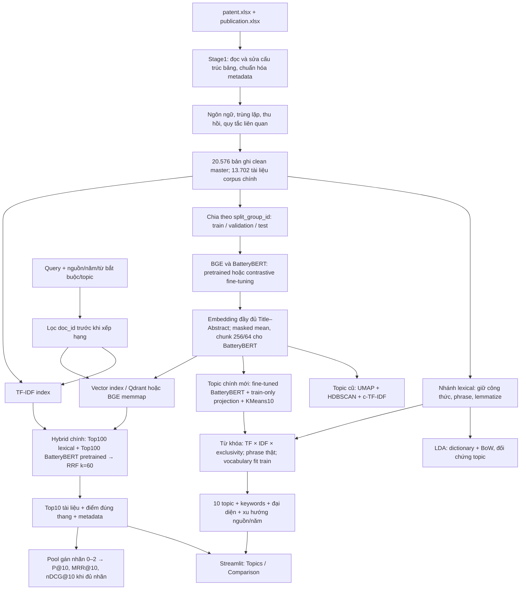

# Pipeline, chẩn đoán và tối ưu BatteryBERT — 23/10/2026

> Đính chính 24/10/2026: vectorizer trong phiên này bảo toàn tính liền kề của chuỗi token đầu vào, nhưng token LDA đã xóa stopword trước đó. Vì vậy, tuyên bố bên dưới rằng mọi ngram đều liền kề trong văn bản gốc là quá mạnh. Nhánh mới lấy token từ Title–Abstract gốc và giữ ranh giới từ bị loại; xem [đính chính và kiểm chứng](KEYWORD_ADJACENCY_CORRECTION_20261024.md). Số đo lịch sử được giữ nguyên, không xem là đã chạy lại bằng representation mới.

## Kết luận theo từng câu hỏi

BatteryBERT fine-tuned + phép chiếu giảm hướng Patent/Publication + KMeans10 là model topic chính mới. Bản này đạt toàn bộ **tiêu chí kỹ thuật định trước**, cho các nhóm vật liệu rõ hơn trong tài liệu được kiểm tra. Đây là lựa chọn triển khai tạm thời theo mục tiêu cân bằng, bớt lệch nguồn và ổn định; chưa phải chiến thắng khoa học có nhãn chuyên gia.

Không có một model tốt nhất cho mọi việc. BatteryBERT HDBSCAN cũ dẫn đầu C_v nhưng hai cụm chứa 92,76% corpus, hầu như tách theo nguồn. BGE có proxy Title→Abstract tốt hơn trong các kết quả test lịch sử đã hoàn tất (pretrained MRR@10=0,8936; fine-tuned=0,9281). BatteryBERT fine-tuned đạt validation proxy=0,8232, so với pretrained=0,4953; chưa có test proxy tương đương của checkpoint này trong báo cáo cũ. Các phép đo khác pooling/chunking/ngân sách nên không diễn giải thành encoder thắng tuyệt đối. Search Top10 vẫn chưa có nhãn người độc lập để kết luận model nào trả tài liệu liên quan tốt nhất.

"10 topic" ở đây là 10 cụm của corpus; mỗi cụm có top10 keywords. "Search Top10" là 10 tài liệu được xếp hạng cho truy vấn, là một bài toán khác.

## Pipeline toàn chương trình



Code tương ứng: `src/pipeline.py`, `src/text_processing.py`, `src/quality.py`; `src/stage2.py`; `src/batterybert.py`, `src/stage3_neural.py`, `src/model_comparison.py`; `src/batterybert_optimization.py`; `src/final_search.py`, `src/final_system_vectors.py`, `src/final_dashboard.py`. App không train khi khởi động. Search mặc định vẫn là TF-IDF + BatteryBERT pretrained/RRF; V2 BGE/BM25/MiniLM và V3 fine-tuned BatteryBERT/BM25/MiniLM được giữ để đối chứng. Topic chính mới dùng encoder **fine-tuned**; tên encoder Search được ghi riêng. Topic không cộng điểm vào xếp hạng.

## Chương trình chưa tốt ở đâu và đã sửa gì

1. **Sai mục tiêu phân cụm:** embedding pretrained BERT và HDBSCAN EOM ưu tiên cấu trúc văn phong/nguồn. Mất cân bằng không có nghĩa phải ép mỗi cụm bằng nhau. KMeans10 cho số cụm yêu cầu, còn phép chiếu học từ train làm giảm hướng phân biệt nguồn. Mỗi tài liệu inference đều dùng cùng phép chiếu, không cần biết nguồn. Phép chiếu có thể bỏ một phần khác biệt khoa học thực sự tương quan với nguồn; vì vậy luôn lưu bản gốc và đọc đại diện.
2. **Fine-tune không tối ưu trực tiếp topic:** positive Title–Abstract, batch2, một epoch, chỉ cập nhật block cuối. Gradient accumulation2 không tạo tập negatives lớn hơn bên trong loss. Khoảng 97,66% abstract train bị cắt ở ngân sách128 tokens, trong khi inference dùng đủ abstract với chunk256/64. Fine-tune giúp proxy nhưng không tự giải quyết nguồn; thử nghiệm `finetuned_raw` vẫn có source V≈0,99.
3. **Từ khóa thiếu tính đại diện:** chỉ tăng diversity hoặc phạt tần suất mạnh làm nổi danh sách công thức hiếm, ít đồng xuất hiện. Đã thử 18 biến thể frequency/exclusivity trên hai phân cụm cố định. Chọn TF power1, IDF=log(1+N/df), exclusivity power0,25; vocabulary chỉ fit train, min_df5, max_df0,6, max_features40.000. Mỗi keyword có ≥5 tài liệu train hỗ trợ. Không tự chế keyword kỹ thuật.
4. **Phrase giả và placeholder:** vectorizer mới chỉ tạo ngram liền kề thực trong tài liệu gốc, không nối qua stopword bị xóa hoặc ranh giới tài liệu. Sửa `lda_tokens` để khôi phục phrase nằm trong từ ghép như `all-solid-state`; không chạy lại hay sửa corpus frozen. Công thức, chữ hoa và token kỹ thuật được giữ theo dữ liệu đã có; không khẳng định phục hồi toàn bộ thông tin đã mất ở tiền xử lý lịch sử.
5. **Báo cáo không đồng bộ:** checkpoint fine-tuned đã train thành công (2.730 optimizer updates lịch sử) nhưng báo cáo model comparison vẫn ghi chưa hoàn tất do bước kiểm tra serialization tokenizer. Đã dùng đúng vector fine-tuned đã được tích hợp sau đó, kiểm tra hash checkpoint và thứ tự doc_id. Không lấy pretrained thay cho fine-tuned.
6. **Thiếu thẩm định relevance và topic:** chưa có nhãn người độc lập cho Search, còn lỗi nhóm trong mẫu đọc. Báo cáo và giao diện ghi rõ; coherence và seed agreement không phải accuracy.

## Thiết kế thử nghiệm và điều kiện dừng

Vòng1 chạy 11 cấu hình embedding/geometry, mỗi cấu hình fit KMeans seed42 và seed43; fit trên10.921 tài liệu train, chọn bằng1.361 validation. Vòng2 chạy18 cấu hình từ khóa trên hai phân cụm fine-tuned có lệch nguồn thấp (bao gồm2 lần tái kiểm tra cấu hình từ khóa ban đầu). Tổng29 lượt cấu hình phát triển; không phải29 encoder neural được train. Không thực hiện gradient update mới và không tính lại transformer embeddings trong lượt này.

Tiêu chí chấp nhận khai báo trước vòng1: đúng10 topic, cụm lớn nhất≤30%, top2≤45%, cụm nhỏ nhất≥0,5%, source Cramér V≤0,5, ARI≥0,6, diversity≥0,75, keyword coverage≥0,95, NPMI validation≥0. **Đây là ngưỡng kỹ thuật do thử nghiệm đặt ra, không phải chuẩn khoa học hay accuracy.** Giữ nguyên các ngưỡng ở vòng2. Chọn cấu hình đạt ngưỡng có NPMI validation cao nhất; cấu hình NPMI cao hơn nhưng diversity thấp bị loại.

Sau khi đóng băng lựa chọn mới chạy1.368 test và seed137 chưa dùng trong lựa chọn. Test split đã tồn tại trong nghiên cứu lịch sử; "held-out" ở đây nghĩa là không dùng để fit/chọn cấu hình trong lượt tối ưu này, không tuyên bố bộ dữ liệu hoàn toàn mới đối với mọi nghiên cứu trước.52 tài liệu chỉ có title được inference, không tham gia fit/selection/test. Không refit toàn corpus sau test. Dừng thay đổi model sau khi vượt cổng cuối; các kiểm tra coherence toàn corpus và đọc đại diện sau đó là mô tả, không dùng để sửa model theo test.

| Chẩn đoán trên test | Kết quả | Ngưỡng |
|---|---:|---:|
| Cụm lớn nhất | 14.25% | ≤30% |
| Hai cụm lớn nhất | 27.05% | ≤45% |
| Cụm nhỏ nhất | 5.48% | ≥0,5% |
| Source Cramér V | 0.3375 | ≤0,5 |
| ARI với seed137 | 0.9245 | ≥0,6 |
| Keyword diversity@10 | 0.80 | ≥0,75 |
| Keyword xuất hiện trong test | 100% | ≥95% |
| Document NPMI | 0.0883 | ≥0 |

Trên toàn13.702 tài liệu: top2=27.49%, cụm lớn nhất=15.06%, source V=0.2975. Baseline HDBSCAN cũ: top2=92,76%, source V=0,9986. Đây là so sánh các pipeline có cả khác biệt encoder, clustering và biểu diễn; không quy mọi cải thiện cho fine-tune. KMeans luôn gán cụm nên0% outlier không chứng minh mọi tài liệu phù hợp.

## Model nào cho 10 topic tốt hơn

Coherence tính lại trên **cùng một reference** của toàn corpus, cùng window110, top10, phrase chính xác,10/10 topic đều đủ coverage:

| Model/pipeline | C_v | Diversity@10 | Nhận định |
|---|---:|---:|---|
| LDA K10 lịch sử | 0.5297 | 0,66 | Đối chứng lexical, không có encoder |
| BERTopic BGE lịch sử | 0.6455 | 0,86 | 22,77% outlier trong kết quả lịch sử |
| BatteryBERT pretrained/HDBSCAN cũ | 0.7436 | 0,92 | C_v cao nhất; top2 chiếm92,76%, lệch nguồn rất mạnh |
| BatteryBERT pretrained/KMeans bản web trước | 0.6941 | 0,81 | Kích thước tốt hơn, vẫn gần như tách theo nguồn |
| BatteryBERT fine-tuned/projection/KMeans mới | 0.5601 | 0,80 | Chọn làm topic chính theo cổng đa tiêu chí, không thắng C_v |

C_v của bản mới giảm0,6941→0,5601 so với web trước; không che giấu đánh đổi. NPMI test của bản mới0,0883, so với pretrained/raw−0,0485, fine-tuned/raw−0,2010 và BGE/raw−0,1987 trong đối chứng KMeans train-only cùng cách trích từ khóa ban đầu. So sánh bản cuối bao gồm cả thay đổi trọng số keywords; không phải encoder-only ablation.

## Mười topic đang hiển thị

Nhãn là diễn giải tạm thời của agent từ keywords và tài liệu đại diện, chưa có chuyên gia xác nhận. ID không tương ứng với ID của model cũ.

| ID | Diễn giải | Tài liệu | Năm từ khóa đầu |
|---|---|---:|---|
| 0 | Anode MoS2, dichalcogenide lớp và MXene | 1,031 | MoS2, graphene, mxene, molybdenum, disulfide |
| 1 | Cathode phosphate vanadium và NASICON | 1,342 | phosphate, vanadium, Na3V2(PO4), nvp, sodium |
| 2 | Cathode Prussian blue và hợp chất sắt | 1,353 | prussian_blue, iron, sodium, solution, prussian |
| 3 | Cấu trúc cell, bộ góp dòng và lắp ráp pin | 1,084 | connect, plate, device, end, electrode |
| 4 | Điện ly, muối, dung môi và polymer | 1,532 | electrolyte, polymer, additive, organic, salt |
| 5 | Anode sulfide/selenide và composite carbon | 1,235 | sulfide, carbon, composite, selenide, CoSe2 |
| 6 | Anode hợp kim Sn/Sb, phosphorus và chuyển hóa | 915 | antimony, sb, tin, sn, anode |
| 7 | Hard carbon, carbon xốp và tiền chất sinh khối | 1,703 | hard_carbon, carbon, biomass, porous, carbonize |
| 8 | Anode oxide Ti/Sn và titanate | 1,444 | TiO2, titanium, titanate, dioxide, SnO2 |
| 9 | Cathode oxide lớp P2/O3 và kim loại chuyển tiếp | 2,063 | P2, layer, oxide, cathode, O3 |

## Tự kiểm tra nội dung và giới hạn còn lại

Đã xem title cùng đoạn đầu abstract của60 tài liệu:3 gần centroid và3 lấy ngẫu nhiên có seed cho mỗi topic. Lưu đầy đủ abstract gốc và chú thích tại `scientific_review.csv`; đây là đánh giá agent, không phải expert ground truth hay ước lượng precision. Ví dụ đúng chủ đề: MoS2/CNT (`publication:WOS:000627423800016`), NASICON phosphate (`publication:WOS:000600805400001`), Prussian blue (`publication:WOS:000792137800013`), hard carbon từ lõi thân ngô (`publication:WOS:000428070800013`).

Các vấn đề đã ghi nhận: sodium iron phosphate nằm gần nhóm Prussian blue (`patent:202235650E`); organic anode PDI nằm trong nhóm điện ly (`publication:WOS:000989869100001`); cathode NaCrO2/C nằm trong nhóm anode oxide (`publication:WOS:000718314900003`); carbon coating cathode ở nhóm hard carbon (`patent:2017766545`). Các nhóm0/5/6 có vùng chồng lấn chuyển hóa–hợp kim–chalcogenide. Nhóm3 là phần cứng pin thực sự có trong corpus và có nhiều patent; không đổi tên nó thành một họ vật liệu giả để đủ10 chủ đề vật liệu. Một số keywords như solution, dry, connect còn xuất hiện vì nội dung tổng hợp/lắp ráp; xóa toàn bộ bằng blacklist sẽ làm đẹp từ khóa mà không sửa tài liệu bị gán lệch.

## Làm BatteryBERT học tốt hơn ở vòng nghiên cứu sau

Ưu tiên gán nhãn một tập scientific topic độc lập theo nhóm tài liệu, gồm cả trường hợp giao thoa và ngoài phạm vi; tách topic label khỏi relevance Search. Dùng positive cùng chủ đề giữa Patent và Publication để chống học văn phong, đồng thời giữ nhóm phần cứng hợp lệ. Dùng hard negatives khác họ vật liệu, tránh coi hai mô tả cùng họ là negative. Khi có GPU, so sánh batch thực16–32 hoặc cached contrastive loss, không coi accumulation là số negatives. So sánh chunk pooling/hierarchical contrastive phù hợp abstract đầy đủ; không mặc định128 tokens đủ. Fine-tune từng1–2 block hoặc adapter, warmup, clipping, checkpoint chọn theo validation khoa học và kiểm tra drift với checkpoint gốc. Giữ BGE và LDA làm đối chứng, không ép BatteryBERT thắng bằng cách đổi dữ liệu hoặc nhãn test.

Chưa train lại neural trong lượt này vì vấn đề nguồn và trọng số keywords đã được kiểm định bằng các thay đổi nhẹ; mục tiêu proxy cũ không bảo đảm tối ưu topic. Khuyến nghị training trên đây là thiết kế cho nghiên cứu tiếp, chưa phải kết quả đã chạy.

## Chạy và tái lập

```powershell
.venv/Scripts/python.exe run_demo.py
# Mở Topics: BatteryBERT fine-tuned · optimized
# Chạy lại thí nghiệm trong thư mục MỚI, tránh sửa phiên bản đã đóng băng:
.venv/Scripts/python.exe scripts/optimize_batterybert.py --output outputs/batterybert_optimization_REPLAY --phase all
.venv/Scripts/python.exe scripts/evaluate_topic_candidates.py --output outputs/batterybert_optimization_REPLAY
# Kiểm thử bản đang tích hợp:
.venv/Scripts/python.exe -m pytest tests/test_unit.py tests/test_batterybert_optimization.py tests/test_optimized_topics.py tests/test_research_completion.py tests/test_final_system.py tests/test_search_v2_app.py -q
```

Đã chạy **80 kiểm thử riêng biệt, 0 lỗi/failure** trong hai XML backend/web; lượt unit ban đầu được chạy lại trong backend nên không cộng trùng. Bao gồm reload/predict đủ13.702 tài liệu, chỉ fit đúng ID train, kiểm tra support thực của100 keywords, dữ liệu/vectors không đổi, đồng nhất topic giữa Search và Topics, bộ lọc trước ranking, truy vấn V3/hybrid thật và giao diện. HTTP smoke: **PASS**; server kiểm tra được dừng cùng các process con do nó tạo. Cảnh báo Qdrant Local về exact search không phải test failure. Không dùng tests kỹ thuật làm bằng chứng relevance.

`topic_pipeline.joblib` là pipeline học thật; truyền vector **fine-tuned BatteryBERT đúng checkpoint/pooling**, không dùng pretrained vector hoặc vector query Search để thay thế. Predict không cần source, không tự đổi encoder. Bản chạy dùng source snapshot trong `code_snapshot/`; các hardening sau chạy (không sửa mảng float64 đầu vào, hoàn thiện CLI/resume) được kiểm thử riêng. Fingerprint cũ cố ý từ chối replay vào thư mục cũ khi code đổi. Reproduction mới có thể khác phần rất nhỏ do package/hardware; dùng package versions đã lưu.

`validation_comparison.csv`, `refined_validation_comparison.csv`, `inductive_test_comparison.csv`, `common_coherence.csv` giữ số đo thật. `final_test.json` là cổng cuối đóng băng; `preservation_check.json` xác minh dữ liệu/vectors giữ nguyên; `artifact_manifest.json` và `package_versions.json` ghi provenance. `deployment.json` chỉ kích hoạt catalog và bộ lọc topic mới. Qdrant hiện hữu không được build/upsert lại: tìm kiếm lọc bằng doc_id, sau đó hiển thị topic mới từ catalog; payload topic cũ trong storage không được xem là nhãn hiện hành.

## Nguồn phương pháp

- [BERTopic — clustering](https://maartengr.github.io/BERTopic/getting_started/clustering/clustering.html): cho phép thay HDBSCAN bằng KMeans; việc có10 cụm không tự bảo đảm chất lượng khoa học.
- [BERTopic — parameter tuning](https://maartengr.github.io/BERTopic/getting_started/parameter%20tuning/parametertuning.html): tách clustering và representation.
- [WhiteningBERT, EMNLP2021](https://aclanthology.org/2021.findings-emnlp.23/): cơ sở thử thay đổi hình học embedding; không bảo đảm whitening thắng trên corpus này.
- [Is anisotropy really the cause..., EMNLP2022](https://aclanthology.org/2022.findings-emnlp.314/): anisotropy không đủ để kết luận chất lượng ngữ nghĩa.

Đánh giá sử dụng hướng dẫn `scientific-critical-thinking` để tách kết quả kỹ thuật, lựa chọn trên development và kết luận khoa học; không áp dụng checklist lâm sàng cho topic modeling.
