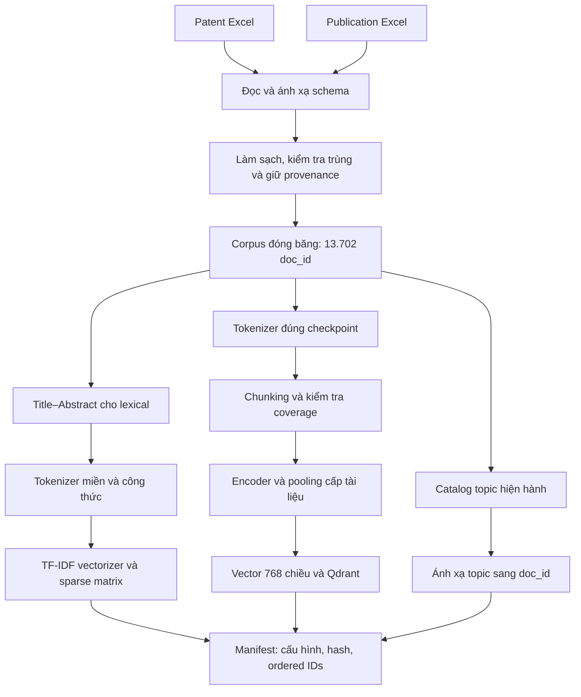
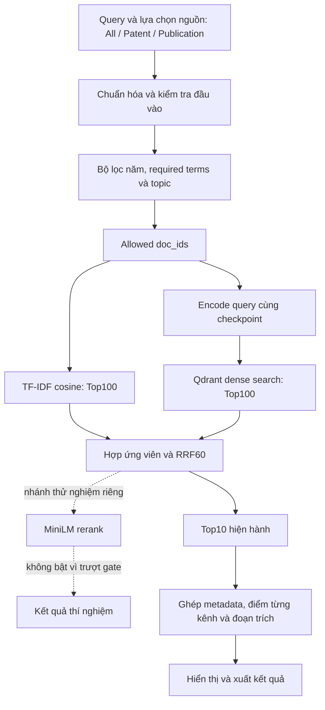

# Kế hoạch hoàn thiện phần search engine cho patents và papers trong báo cáo hiện có

**Phạm vi:** hệ thống Sodium-ion Research Explorer và corpus patents/papers đã có trong dự án.  
**Mục tiêu bàn giao:** một phần báo cáo LaTeX giải thích trọn vẹn bài toán, các hướng tiếp cận, pipeline, công thức, triển khai, đánh giá, kết quả, ví dụ và giới hạn.  
**Mốc bằng chứng:** các artifacts đã có đến ngày 26/10/2026. Các mục “cần bổ sung thực nghiệm” dưới đây là công việc dự kiến, không phải kết quả đã thực hiện.

## 1. Chốt câu chuyện chính của phần search

Phần search cần trả lời xuyên suốt câu hỏi:

> Từ một nhu cầu nghiên cứu về pin sodium-ion, hệ thống tìm và xếp hạng những patents hoặc papers nào; vì sao chọn cách tìm đó; và đánh giá mức phù hợp bằng bằng chứng nào?

Đóng góp chính cần trình bày là **xây dựng và đối chiếu một search engine trên hai nguồn tài liệu có văn phong khác nhau**, tận dụng cả tín hiệu từ khóa và biểu diễn ngữ nghĩa. Nội dung phải đi từ nhu cầu người dùng đến kết quả truy hồi, không chỉ liệt kê tên model.

Các câu hỏi nghiên cứu:

- **RQ1 — Đối chứng phương pháp:** lexical, semantic và hybrid khác nhau thế nào trên cùng corpus và bộ query?
- **RQ2 — Biểu diễn tài liệu:** BatteryBERT full-document thay đổi kết quả thế nào so với pretrained BatteryBERT và BGE?
- **RQ3 — Xếp hạng lại:** reranker đã thử có cải thiện ổn định trên tập giữ riêng không?
- **RQ4 — Hai nguồn dữ liệu:** kết quả chung đã phản ánh đầy đủ nhu cầu tìm patents và papers chưa? Còn thiếu phép đo nào theo nguồn?
- **RQ5 — Truy vấn nhiều điều kiện:** tài liệu có đúng vật liệu nhưng thiếu công đoạn, vai trò điện cực hoặc điều kiện thí nghiệm được nhận diện ra sao?

**Định vị:** báo cáo một hệ thống ứng dụng và thực nghiệm so sánh. Không tuyên bố một thuật toán truy hồi mới nếu chưa có đóng góp phương pháp tương ứng.

## 2. Dữ liệu patents và papers đang có

| Nội dung | Patents | Papers / Publication |
|---|---:|---:|
| Số tài liệu corpus chính | 5.933 | 7.769 |
| Title có nội dung | 5.933 | 7.769 |
| Abstract có nội dung | 5.933 | 7.717 |
| Abstract thiếu | 0 | 52 |
| Trường thời gian cần giải thích | `year`, `priority_year`, `year_basis` | `year`, `year_basis` |
| Trường dùng truy hồi hiện hành | Title–Abstract | Title–Abstract |

Nguồn kiểm tra: `data/processed/main_corpus.parquet`, gồm 13.702 `doc_id` duy nhất. Thống kê có/thiếu ở đây tính trên trường không null và không rỗng, chưa thay cho audit giá trị hợp lệ.

Cần viết rõ hai nguồn khác nhau ở nhu cầu sử dụng:

- **Papers:** thường tìm vật liệu, cơ chế, thông số, phương pháp và bằng chứng nghiên cứu.
- **Patents:** thường tìm giải pháp kỹ thuật, thành phần, quy trình, thiết bị hoặc tổ chức liên quan.
- **Tìm chung:** phục vụ khám phá cả nghiên cứu và giải pháp kỹ thuật; không ép số lượng hai nguồn bằng nhau sau khi nhìn kết quả.

Hệ thống hiện có Title–Abstract và metadata. Chưa có căn cứ viết rằng đã lập chỉ mục toàn văn papers, toàn bộ mô tả patents hoặc claims. Tìm được patent theo Abstract cũng chưa đồng nghĩa phân tích phạm vi bảo hộ của claims.

Schema nên minh họa trong báo cáo:

```text
doc_id, source, title, abstract, identifier,
year, year_basis, priority_year,
authors, organization, keywords, classification,
source_file, source_sheet, source_row, split_group_id
```

`classification` cần đối chiếu ý nghĩa theo từng nguồn trước khi đặt tên bộ lọc IPC/CPC hoặc phân ngành papers. Các trường metadata đã có không mặc nhiên đều được dùng để tính ranking hiện hành.

## 3. Có mấy hướng? Tổ chức thành 4 họ phương pháp

**Bốn họ phương pháp không đồng nghĩa bốn model.** Trong hệ thống đã có sáu cấu hình search được đánh giá chung và một nhánh reranker thử nghiệm riêng.

| Hướng | Nội dung trình bày | Cấu hình / bằng chứng trong dự án | Vai trò |
|---|---|---|---|
| **H1. Lexical retrieval** | Tìm bằng từ khóa, tên vật liệu, công thức | TF-IDF cosine; BM25 thuộc Search v2 lịch sử | Baseline dễ kiểm tra |
| **H2. Semantic retrieval** | Encode query/document và so độ tương tự | BatteryBERT pretrained; BGE; BatteryBERT full-document | Đối chứng encoder và cách biểu diễn |
| **H3. Hybrid retrieval** | Hợp kết quả lexical và semantic bằng RRF | BatteryBERT hybrid; full-document hybrid | Trục chính của hệ thống hiện hành |
| **H4. Hybrid + reranking** | Lấy ứng viên rồi dùng cross-encoder xếp lại | MiniLM rerank Top30/Top50 ở phiên revision | Thử nghiệm đã có; Top30 không qua gate nên không bật |

### Quyết định về nội dung

1. Dành nhiều dung lượng nhất cho **H3**, vì đây là cấu hình hiện hành và có bảng relevance mới nhất.
2. Viết **H1 và H2** đủ chi tiết để người đọc hiểu mỗi kênh đóng góp gì cho H3.
3. Giữ **H4** và kết quả không đạt để giải thích tại sao hệ thống không mặc định dùng reranker.
4. Đưa SE1/SE2/SE3 và Search v2 vào mục lịch sử/đối chứng. Không gọi chúng là cấu hình hiện hành.
5. Topic modeling là thành phần hỗ trợ duyệt/lọc. Không tính LDA/BERTopic thành một hướng search chính mới nếu chỉ đang dùng topic để lọc `doc_id`.
6. RAG hoặc chatbot trả lời là phần mở rộng sau truy hồi, không phải kết quả đã triển khai trong phạm vi search này.

## 4. Pipeline tổng thể: tách offline và online

### 4.1. Pipeline offline — chuẩn bị và lập chỉ mục



Mỗi khối phải có **đầu vào, thao tác và đầu ra**. Cần nhấn mạnh corpus, checkpoint, tokenizer và index phải cùng phiên bản; đúng số chiều chưa đủ bảo đảm tương thích.

### 4.2. Pipeline online — truy vấn đến Top10



Các điểm cần diễn giải dưới sơ đồ:

- Lọc trên tập hợp lệ **trước khi lấy ứng viên**, áp dụng nhất quán cho hai nhánh.
- Topic đổi membership sẽ đổi allowed IDs, không tự cộng điểm vào ranking.
- Top100 + Top100 tạo hợp tối đa 200 tài liệu, không bảo đảm luôn đủ 200.
- Query dài của nhánh full-document được xử lý theo cơ chế cửa sổ; không mô tả nhầm bằng giới hạn 128-token của nhánh cũ.
- Khi lexical không có ứng viên nhưng dense có, nhánh full-document hybrid có thể tiếp tục từ dense.
- Đoạn trích hiện hành là câu có overlap lexical tốt; chưa phải kiểm chứng neural rằng mọi điều kiện query được đáp ứng.

## 5. Công thức phải viết trong báo cáo

Mỗi công thức cần kèm định nghĩa ký hiệu, vị trí trong pipeline và giới hạn diễn giải.

### 5.1. TF-IDF và cosine lexical — H1

Với (N) tài liệu, (df(t)) là số tài liệu chứa từ (t), (f(t,d)) là tần suất:

\[
idf(t)=\log\frac{1+N}{1+df(t)}+1,
\qquad \widetilde{x}_{dt}=f(t,d)idf(t).
\]

\[
x_d=\frac{\widetilde{x}_d}{\|\widetilde{x}_d\|_2},
\qquad s_L(q,d)=x_q^\top x_d.
\]

Viết đúng cấu hình hiện hành: Title nối Abstract, tokenizer riêng, L2, smooth IDF, TF không sublinear. TF-IDF của search khác c-TF-IDF dùng đặt từ khóa topic.

### 5.2. BM25 — giải thích đối chứng lịch sử

\[
s_{BM25}(q,d)=\sum_{t\in q}IDF(t)
\frac{f(t,d)(k_1+1)}{f(t,d)+k_1(1-b+b|d|/avgdl)}.
\]

Chỉ đưa cùng cấu hình thực sự của nhánh lịch sử; không đổi nhãn baseline hiện hành từ TF-IDF thành BM25. Nếu sau này thử trọng số theo trường, phải ghi đó là thí nghiệm mới và nêu chính xác cách hợp điểm.

### 5.3. Biểu diễn neural và cosine — H2

Với (H_i) là hidden state token, (m_i) là mask pooling nội dung:

\[
h(x)=\frac{\sum_i m_iH_i}{\sum_i m_i},
\qquad e(x)=\frac{h(x)}{\|h(x)\|_2}.
\]

BatteryBERT dùng pooling theo từng phiên bản; BGE trong dự án sử dụng CLS. Với các vector chuẩn hóa:

\[
s_D(q,d)=e_q^\top e_d.
\]

**Full-document pooling:** với (a_j) là số token Abstract mới của chunk (j), (e_{dj}) là chunk embedding chuẩn hóa:

\[
e_d=\operatorname{L2Norm}\left(\frac{\sum_j a_je_{dj}}{\sum_j a_j}\right).
\]

Nêu chunk256/overlap64 và Title context. Trọng số token mới không loại overlap khỏi attention bên trong chunk. Đọc đủ cửa sổ không tạo attention toàn cục giữa mọi đoạn.

### 5.4. Loss nếu trình bày cách train encoder

\[
S_{ij}=\frac{e_{q_i}^{\top}e_{d_j}}{\tau},
\qquad L_{q\to d}=-\frac1B\sum_i\log\frac{\exp S_{ii}}{\sum_{j\in A_i}\exp S_{ij}}.
\]

\[
L_{CL}=\tfrac12(L_{q\to d}+L_{d\to q}).
\]

Phần continuation hiện có thêm distillation trọng số0,02; batch32, temperature0,05, gradient caching, khóa11 block và cập nhật block cuối. Cần ghi đủ loss thực tế khi viết bản LaTeX cuối. Positive là Title–document cùng tài liệu; negative cùng nhóm hoặc gần trùng được mask. Đây là huấn luyện proxy, khác nhãn relevance của20 truy vấn tự nhiên.

### 5.5. Reciprocal Rank Fusion — H3

\[
s_{RRF}(d)=\sum_{m:d\in R_m}\frac1{k+r_m(d)},\qquad k=60.
\]

Hạng bắt đầu từ1; vắng một nhánh thì không nhận điểm nhánh đó. Cấu hình hiện hành dùng hai nhánh trọng số bằng nhau. RRF hợp thứ hạng thay vì cộng trực tiếp hai loại cosine.

**Ví dụ minh họa công thức, không phải benchmark:** A ở lexical hạng1/dense hạng10 nhận (1/61+1/70\approx0,030679); B ở hạng4/4 nhận (2/64=0,03125). Vì vậy B xếp trên A dù A đứng đầu lexical.

### 5.6. Cross-encoder — H4

\[
s_{CE}(q,d)=\operatorname{Agg}_{p\in P_d}g_\psi(q,p).
\]

(P_d) là các passages và Agg phải viết đúng cách tổng hợp của phiên bản thử nghiệm, đối chiếu mã đã đóng băng trước khi chốt công thức chi tiết. Không mặc định mọi reranker dùng max hoặc có đầu ra là xác suất relevance đã hiệu chuẩn. Reranker chỉ xếp lại ứng viên đã có.

### 5.7. Điểm retrieval không phải relevance

Phải có một bảng phân biệt:

| Đại lượng | Ý nghĩa | Không được diễn giải thành |
|---|---|---|
| TF-IDF cosine | Gần nhau trong biểu diễn lexical | Xác suất đúng nội dung |
| Dense cosine | Gần nhau trong embedding | Search accuracy |
| RRF | Điểm hợp thứ hạng | Phần trăm phù hợp |
| Cross-encoder score | Điểm mô hình trên một cặp | Xác nhận mọi điều kiện khoa học |
| Relevance grade | Nhãn theo rubric và bằng chứng nguồn | Giá trị suy trực tiếp từ các score trên |

## 6. Kết quả đã có: đưa vào bài ngay

### 6.1. Sáu phương pháp trên703 Silver Labels

| Phương pháp | P@10 | nDCG@10 | MRR@10 |
|---|---:|---:|---:|
| TF-IDF | 0,4500 | 0,6719 | 0,6917 |
| BatteryBERT semantic | 0,2650 | 0,4457 | 0,5005 |
| BatteryBERT hybrid | 0,5050 | 0,7499 | 0,7238 |
| BGE semantic | 0,5300 | 0,7399 | 0,7383 |
| Full-document semantic | 0,4500 | 0,6786 | 0,7250 |
| Full-document hybrid | **0,5400** | **0,7693** | **0,7767** |

Nguồn: `outputs/ai_silver_labels_703_20261026_v1/evaluation/metrics_summary.csv`.

**Cách nhận xét:** hybrid full-document cao nhất về trung bình trong lần đánh giá này. Đây là703 nhãn AI/20 queries, chưa là nhãn chuyên gia. Chênh lệch với BGE và BatteryBERT hybrid còn bất định; paired CI đã lưu chứa0 cho ba chỉ số. Không kết luận thắng tổng thể trên mọi người dùng hoặc riêng từng nguồn.

### 6.2. Kết quả encoder đã train

| Protocol Title–full-document proxy | Trước continuation | Sau continuation |
|---|---:|---:|
| Validation Group MRR@10 | 0,906174 | 0,933093 |
| Test Group MRR@10 | 0,887839 | 0,924704 |

Nguồn: `outputs/batterybert_full_document_20261024_v1/paired_training_effect.json`. Có Title context, nên đây là proxy chọn/đo biểu diễn; không chuyển thành “92,47% search accuracy”.

### 6.3. Kết quả reranker cần giữ cả trường hợp không đạt

| Proxy Group MRR@10 | Hybrid baseline | Rerank Top30 |
|---|---:|---:|
| Dev16 | 0,832813 | 0,877083 |
| Gate16 | 0,927083 | 0,850694 |

Nguồn: `outputs/research_revision_20261025_v1/comparison/search_proxy_comparison.csv`.

Reranker tăng dev nhưng giảm gate nên không bật. Đây là thí nghiệm trên title anchors, không gộp vào bảng relevance703 nhãn.

### 6.4. Hình kết quả cần đặt đúng vị trí

| Vị trí trong bài | Hình / nguồn hiện có |
|---|---|
| Sau phần train encoder | `outputs/batterybert_full_document_20261024_v1/learning_curve.png` |
| Sau bảng sáu methods | `outputs/ai_silver_labels_703_20261026_v1/evaluation/figures_v2/method_comparison.png` |
| Khi phân tích query khó | `.../evaluation/figures_v2/query_heatmaps.png` |
| Khi phân tích độ nhạy nhãn | `.../evaluation/figures_v2/threshold_sensitivity.png` |
| Khi giải thích bỏ reranker | `outputs/research_revision_20261025_v1/visualizations/search_gate_rejection.png` |
| Ví dụ truy hồi thật | Bảng Q01 từ `rankings_with_silver_labels.csv`; hình đã dựng trong `course_report_latex/figures/q01_search_results.png` |
| Sơ đồ kiến trúc search | Viết lại bằng TikZ trong LaTeX theo pipeline ở mục4; sơ đồ phải phản ánh cấu hình hiện hành |
| Ảnh giao diện | Chọn ảnh đã lưu phù hợp; ghi rõ snapshot lịch sử nếu chưa có ảnh giao diện hiện hành |

Mỗi hình cần caption, nguồn artifact, phiên bản, phạm vi dữ liệu và đoạn nhận xét giải thích hình trả lời câu hỏi gì. Hình dựng từ CSV phải được gọi đúng là hình dựng lại, không phải ảnh chụp giao diện mới.

## 7. Lấy ví dụ thực sự trong bài

### 7.1. Q01 — Papers, hard carbon từ biomass

Query: **“Hard carbon anodes derived from biomass for sodium-ion batteries.”**

| Hạng hybrid | Paper | Nhãn Silver | Ý nghĩa |
|---|---|---:|---|
| 1 | Biomass-derived carbon anodes for sodium-ion batteries | 1 | Đúng vùng nội dung, Abstract chưa xác nhận hard carbon cụ thể |
| 2 | Biomass hard carbon of high initial coulombic efficiency for sodium-ion batteries: Preparation and application | 2 | Abstract xác nhận hard carbon từ biomass làm anode SIB |
| 3 | Biochars from various biomass types as precursors for hard carbon anodes in sodium-ion batteries | 2 | Trực tiếp nghiên cứu biomass làm tiền chất hard carbon |

Viết chuỗi minh họa: query → các tín hiệu biomass/hard carbon/anode/sodium-ion → lexical/dense → fusion → Top10 → nhãn và bằng chứng. Bảng toàn bộ10 hạng đã có trong báo cáo. Với grades theo rank là ([1,2,2,2,2,2,2,2,2,2]), P@10=0,9; RR@10=0,5; nDCG@10≈0,853272 theo pool chung.

### 7.2. Q16 — Patents, thiết bị coating và roll pressing

Query: **“Roll pressing and electrode coating equipment for sodium-ion batteries.”**

- Hạng1 là `patent:202343639C`, về thấm electrolyte trong soft-packed sodium-ion battery; nhãn1 vì rolling để hỗ trợ thấm electrolyte khác electrode calendering.
- Hạng2 là `patent:2023531455`, về electrode sheet/slurry thermal-insulation coating; nhãn1 vì chưa xác nhận đúng equipment/roll press.
- Hạng3 là `patent:202222618G`, mô tả cathode preparation với slurry/foil, hot-air drying và hot-press rollers; nhãn2 theo lượt chấm Silver.

Ví dụ này minh họa **đúng token chưa đủ đúng công đoạn**. Dùng đúng Title–Abstract và rationale đã lưu; không tự suy nội dung claims không có trong corpus.

### 7.3. Q20 — Papers, nhiều điều kiện trong cùng một full cell

Query: **“Hard carbon full cells with layered oxide cathodes and electrolyte additives.”**

Các điều kiện phải cùng được hỗ trợ: hard-carbon anode; layered-oxide cathode; full-cell configuration; electrolyte additive. Bài chỉ nói HC/layered oxide nhưng chưa xác nhận additive được chấm1.

Full-document hybrid không có bài nhãn2 trong Top10. BGE semantic có bài nhãn2 ở hạng10:

> The effects of the functional electrolyte additive on the cathode material Na0.76Ni0.3Fe0.4Mn0.3O2 for sodium-ion batteries

ID: `publication:WOS:000439134600040`.

Ví dụ này cho thấy không có phương pháp tốt nhất cho mọi query và cần xem lỗi mất ứng viên, hòa loãng thông tin khi pooling và quan hệ giữa nhiều điều kiện.

Nguồn chung ba ví dụ: `outputs/ai_silver_labels_703_20261026_v1/evaluation/rankings_with_silver_labels.csv`. Các giải thích relevance là Silver reasoning, chưa có xác nhận chuyên gia.

## 8. Kế hoạch đánh giá: đầy đủ và tách đúng mục tiêu

### 8.1. Giao thức đã có

- 20 queries Q01–Q20.
- Pool chung703 cặp duy nhất, hợp kết quả của sáu methods.
- 120 nhóm query–method và1.200 vị trí Top10.
- Nhãn0: không đáp ứng; nhãn1: liên quan một phần; nhãn2: trực tiếp đáp ứng query.
- Có70 trường hợp cần review,28 bản ghi thiếu Abstract.
- AI đọc Query–Title–Abstract trước khi ghép model/rank; không suy grade từ cosine/RRF.
- Ngưỡng primary cho P/MRR là grade2; nDCG dùng graded gain.

### 8.2. Công thức đánh giá

Với (g_i\in\{0,1,2\}), (rel_i=\mathbf1[g_i=2]):

\[
P@10(q)=\frac1{10}\sum_{i=1}^{10}rel_i.
\]

\[
RR@10(q)=\begin{cases}
1/\min\{i\le10:rel_i=1\},&\text{có bài grade2 trong Top10},\\
0,&\text{ngược lại},
\end{cases}
\qquad MRR@10=\frac1{|Q|}\sum_q RR@10(q).
\]

\[
DCG@10(q)=\sum_{i=1}^{10}\frac{2^{g_i}-1}{\log_2(i+1)},
\qquad nDCG@10(q)=\frac{DCG@10(q)}{IDCG@10(q)}.
\]

IDCG lấy thứ tự lý tưởng từ pool chung; nếu IDCG=0 thì policy hiện có giữ nDCG=0. Macro-average giữ cùng tập query. Không coi nhãn thiếu là0.

\[
Recall_{pool}@K=\frac{|R_K(q)\cap G_{pool}(q)|}{|G_{pool}(q)|}.
\]

Nếu pool không có bài grade2, Recall_pool không xác định. Recall_pool không phải recall trên toàn corpus; chưa có qrels đầy đủ thì không công bố recall toàn corpus.

### 8.3. Bổ sung đánh giá riêng patents/papers — hiện chưa có kết quả tương đương

| Chế độ cần đánh giá | Cách làm | Điều cần kiểm soát |
|---|---|---|
| Papers-only | Chạy lại retrieval với filter Publication trước lấy ứng viên | Query phù hợp nghiên cứu; pool và IDCG của protocol riêng |
| Patents-only | Chạy lại retrieval với filter Patent trước lấy ứng viên | Query về giải pháp/quy trình/thiết bị; rubric theo nhu cầu |
| All sources | Giữ benchmark hỗn hợp và mở rộng có kiểm soát | Cùng query và rubric cho mọi method |

**Không lấy Top10 chung rồi xóa papers để gọi phần còn lại là kết quả Patent-only**, hoặc làm ngược lại. Bộ lọc thay đổi candidate universe và thứ hạng; phải có run riêng. Nếu một query không phù hợp một nguồn, tiêu chí áp dụng phải khóa trước khi xem kết quả, không bỏ query để nâng điểm.

Không chọn một phương pháp chuyên Patent hay Paper chỉ từ bảng aggregate hiện tại. Các bảng per-source chưa có phải để “chưa đo”, không tự điền số.

### 8.4. Tách phát triển và đánh giá mới

1. Giữ20 queries đã xem và703 Silver Labels như benchmark chẩn đoán lịch sử.
2. Tạo bộ phát triển mới theo intent và query-family, có cả Patent-only, Paper-only và All.
3. Khóa một tập query-family mới để đánh giá sau lựa chọn; số lượng được chốt theo ngân sách annotation, không gọi20 query cũ là test chưa nhìn.
4. Nhóm trùng theo identifier và near-duplicate; dùng patent family/DOI khi có dữ liệu đáng tin cậy, không giả định mọi quan hệ family đã có.
5. Với nhãn mới, ưu tiên hai người đọc độc lập, rubric thống nhất và phân xử. Báo agreement/kappa chỉ khi có dữ liệu phù hợp.
6. Nếu mở rộng pool từ method mới, giữ version cũ và version mới, chấm bổ sung rồi tính lại mọi method trên cùng protocol/pool mới.

### 8.5. Độ trễ, tài nguyên và bất định

- Báo p50/p95 cho request đầu tiên và warm requests riêng; nêu hardware, threads, cache, query length và sample size.
- Tách encode query, lexical, vector retrieval, fusion/rerank và metadata; không lấy thời gian cache0 làm end-to-end latency.
- Các file latency hiện có19 warm requests/method chỉ hỗ trợ mô tả thực nghiệm nhỏ; cần thêm requests nếu muốn ước lượng tail latency đáng tin cậy.
- Đo bộ nhớ, kích thước index, thời gian build/rebuild và tác động filter; concurrency là phép đo còn thiếu.
- Bootstrap ghép cặp theo query; nếu nhiều query cùng family thì cân nhắc đơn vị resampling theo family. Báo delta và CI, không chỉ trung bình.
- Kiểm độ nhạy ngưỡng grade và các nhãn review; khoảng bootstrap với nhãn cố định không bao gồm sai số của AI judge.

### 8.6. Ablation cần có nếu thực hiện thí nghiệm tiếp

Ưu tiên các đối chứng giữ một yếu tố thay đổi:

- Lexical-only / dense-only / hybrid, cùng corpus và filter.
- BatteryBERT pretrained / continuation full-document, giữ pooling tương đương khi muốn đo tác dụng training.
- Document-vector / passage-vector là một thí nghiệm biểu diễn riêng, không gộp gain với training.
- Candidate budget và RRF k; khóa lưới trên dev trước khi xem heldout.
- Hybrid / reranker, giữ candidate set và protocol.
- Có/không topic filter theo cùng ý định duyệt; không dùng coherence của topic thay chất lượng search.

Sáu methods đã có trả lời được một phần; không gọi mọi chênh lệch giữa hai pipeline nhiều thay đổi là ablation một yếu tố.

```mermaid
flowchart LR
    A[Query families và corpus có version] --> B[Khóa protocol và splits]
    B --> C[Chạy cùng queries và filters cho mọi method]
    C --> D[Pool ứng viên, ẩn method và rank]
    D --> E[Chấm Query–Title–Abstract theo rubric]
    E --> F[Kiểm missing, duplicate và disputed labels]
    F --> G[Tính P, nDCG, MRR và pooled recall]
    G --> H[So sánh ghép cặp, độ trễ và phân tích lỗi]
    H --> I[Chấp nhận hoặc giữ baseline theo tiêu chí đã khóa]
```



## 9. Những nội dung cần bổ sung ngoài danh sách ban đầu

| Phần bổ sung | Lý do cần có | Đầu ra cụ thể |
|---|---|---|
| Yêu cầu chức năng và phạm vi dữ liệu | Biết hệ thống tìm được nội dung nào | Bảng input/output và chế độ nguồn |
| Phân biệt tìm papers và patents | Khác ý định, văn phong, metadata | Hai ví dụ và kế hoạch đánh giá riêng |
| ID, provenance, phiên bản index | Tránh ghép nhầm metadata và embedding | Sơ đồ schema và manifest |
| Mốc thời gian | Năm ưu tiên patent khác năm công bố paper | Giải thích year_basis/priority_year |
| Ranh giới công thức hóa học | Tránh cắt NVP hoặc nối nhầm TiO2 (101) | Ví dụ raw → normalized, giữ raw span |
| Query không hợp lệ/không có kết quả | Đầu ra có thể kiểm tra được | Trạng thái rỗng, thông báo phạm vi filter |
| Duplicate và grouping | Tránh danh sách bị trùng hoặc rò rỉ train/test | Policy group ID; family/DOI nếu có |
| Tính đúng của filter | Search score tốt nhưng sai nguồn vẫn sai yêu cầu | Kiểm mọi result thỏa source/year/terms/topic |
| Bằng chứng theo điều kiện | Đúng họ vật liệu chưa đủ đúng intent | Bảng điều kiện Q01/Q16/Q20, supported/unsupported/unknown |
| Phân tích lỗi | Biết cải thiện bước nào | Lỗi ứng viên, xếp hạng, metadata, pooling, intent |
| Kết quả không đạt | Giải thích lựa chọn kiến trúc | Bảng reranker dev/gate và quyết định |
| Khả năng tái lập | Người khác truy được con số | Config, command, hash và nguồn bảng/hình |
| Cập nhật dữ liệu và rollback | Index cần đúng version sau thay đổi | Thiết kế index version riêng, kiểm tra rồi đổi cấu hình |
| Trải nghiệm đọc kết quả | Người dùng hiểu vì sao một bài xuất hiện | Title, source, year, identifier, passage, ý nghĩa score |
| Bất định và hạn chế nhãn | Tránh kết luận vượt bằng chứng | CI, sensitivity, trạng thái Silver/human |

Các mục mô tả cơ chế chưa có trong code phải được ghi là thiết kế dự kiến. Không biến một đề xuất như semantic evidence verification thành chức năng đã triển khai chỉ bằng cách vẽ thêm vào sơ đồ.

## 10. Bố cục đề nghị khi sửa báo cáo LaTeX

1. **Bài toán search patents/papers:** nhu cầu, input/output, corpus và phạm vi.
2. **Bốn hướng tiếp cận:** lý do chọn, khác biệt, điểm mạnh/yếu và trạng thái đã thử.
3. **Pipeline và kiến trúc:** offline/online, schema, index và filters.
4. **Công thức và thuật toán:** TF-IDF, dense/pooling, loss liên quan, RRF, reranker.
5. **Triển khai:** mã nguồn chính, định danh checkpoint/index, request/response và xử lý lỗi.
6. **Thiết kế đánh giá:** queries, pool, nhãn, metrics, split, uncertainty, per-source protocol.
7. **Kết quả:** sáu methods, encoder proxy và reranker ở ba bảng protocol riêng; hình tương ứng.
8. **Ví dụ thực tế:** Q01 cho papers; Q16 cho patents; Q20 cho nhiều điều kiện và trường hợp không thành công.
9. **Thảo luận:** tác dụng hybrid, giới hạn pooling, sai metadata, khác biệt nguồn và đánh đổi độ trễ.
10. **Kết luận và phần còn thiếu:** chọn cấu hình theo bằng chứng; các phép đo chưa có được liệt kê rõ.

Trong bộ nguồn hiện có, nội dung chủ yếu cập nhật `chapters/05_search.tex`, `chapters/06_evaluation.tex` và phần pipeline của `chapters/03_pipeline.tex`. Cơ sở encoder/train tham chiếu sang chương2/4 để tránh lặp dài. Các công thức được viết bằng môi trường LaTeX; sơ đồ chính dùng TikZ, không chụp ảnh công thức.

## 11. Thứ tự thực hiện và tiêu chí hoàn thành

| Bước | Công việc | Đầu ra | Tiêu chí hoàn thành |
|---|---|---|---|
| **B1. Kiểm kê bằng chứng** | Đối chiếu code, config, corpus, rankings, metrics, hình | Evidence inventory, bảng trạng thái | Mọi số liệu có nguồn; hiện hành/lịch sử/dự kiến tách rõ |
| **B2. Chốt lập luận** | Viết bài toán và4 họ phương pháp | Outline và bảng model–vai trò–protocol | Giải thích được vì sao hybrid là trục chính |
| **B3. Viết pipeline và lý thuyết** | Viết input/output mỗi khối, công thức, schema | Hai sơ đồ kiến trúc và các công thức | Mô tả khớp mã thực thi và checkpoint/pooling |
| **B4. Ghép kết quả và ví dụ** | Sinh bảng từ CSV, chèn hình, chọn Q01/Q16/Q20 | Bảng metrics, hình kết quả, walkthrough | Không chép sai rank/grade; ví dụ đúng nguồn Patent/Publication |
| **B5. Viết đánh giá và phần thiếu** | Giao thức Silver, CI, lỗi, per-source chưa đo | Mục evaluation và bảng gap | Không tự suy per-source scores hoặc recall toàn corpus |
| **B6. Thực nghiệm bổ sung nếu cần** | Ưu tiên source-filter runs và nhãn độc lập; chỉ thử model mới khi có câu hỏi rõ | Output version mới, pool và protocol riêng | Không tuning trên tập đánh giá đã xem; baseline giữ nguyên |
| **B7. Hoàn thiện tài liệu** | Biên dịch, kiểm tham chiếu, bảng/hình, render từng trang | PDF và ZIP nguồn LaTeX | Hình đọc được, công thức rõ, không tràn trang, nguồn đầy đủ |

B1–B5 và B7 có thể thực hiện bằng artifacts hiện có. B6 phụ thuộc việc có cần thêm kết quả và khả năng annotation; không chặn việc viết chính xác những gì đã có. Chưa ấn định thời lượng train hoặc annotation khi chưa chốt ngân sách và số query mới.

## 12. Tiêu chí chọn phương án và nghiệm thu

- **Bản báo cáo:** người đọc truy vết được một query từ đầu vào đến Top10, hiểu mỗi score, biết nguồn nào được tìm, biết nhãn đến từ đâu.
- **Tính đúng hệ thống:** các ID khớp; tokenizer/checkpoint/index đúng version; filter không sai; text thiếu không bị sinh bù; các trạng thái rỗng rõ ràng.
- **Chất lượng truy hồi:** P@10/nDCG@10/MRR@10 trên cùng protocol, phân tích query khó, CI ghép cặp và kiểm nhãn cần review.
- **Chất lượng theo nguồn:** chỉ công bố kết quả Patent-only/Paper-only khi đã có runs và pool hợp lệ cho từng chế độ.
- **Hiệu năng:** đo trên cùng môi trường và chế độ cache; mục tiêu latency là yêu cầu cần thống nhất, không phải số đo tự giả định.
- **Promote ứng viên:** khóa trước tiêu chí cải thiện có ý nghĩa thực tế, mức suy giảm chấp nhận được ở nhóm Patent/Paper và ngân sách độ trễ. Sau đó mới mở heldout. Nếu chưa có lợi ích đủ rõ, giữ baseline và lưu kết quả không đạt.
- **Khả năng bàn giao:** PDF đọc được; ZIP có đủ `.tex`, sơ đồ/hình, bibliography, bảng sinh từ dữ liệu và hướng dẫn biên dịch.

## 13. Tài liệu phương pháp và bằng chứng

Các nguồn phương pháp để dẫn khi viết bản LaTeX:

- TF-IDF và cấu hình vectorizer: [scikit-learn — TfidfVectorizer](https://scikit-learn.org/stable/modules/generated/sklearn.feature_extraction.text.TfidfVectorizer.html).
- RRF và công thức hợp thứ hạng: [Cormack, Clarke và Büttcher, SIGIR2009](https://plg.uwaterloo.ca/~gvcormac/cormacksigir09-rrf.pdf).
- Bi-encoder/cross-encoder và retrieve-then-rerank: [Sentence Transformers — Cross-Encoders](https://www.sbert.net/examples/cross_encoder/applications/README.html).
- Payload filtering: [Qdrant — Filtering](https://qdrant.tech/documentation/search/filtering/).

Nguồn số liệu dự án:

```text
data/processed/main_corpus.parquet
src/final_search.py
src/full_document_retrieval.py
src/full_document_inference.py
outputs/research_revision_20261025_v1/deployment.json
outputs/batterybert_full_document_20261024_v1/queries.csv
outputs/batterybert_full_document_20261024_v1/paired_training_effect.json
outputs/research_revision_20261025_v1/comparison/search_proxy_comparison.csv
outputs/ai_silver_labels_703_20261026_v1/label_summary.json
outputs/ai_silver_labels_703_20261026_v1/evaluation/metrics_summary.csv
outputs/ai_silver_labels_703_20261026_v1/evaluation/metrics_per_query.csv
outputs/ai_silver_labels_703_20261026_v1/evaluation/rankings_with_silver_labels.csv
outputs/ai_silver_labels_703_20261026_v1/evaluation/confidence_intervals.csv
outputs/ai_silver_labels_703_20261026_v1/evaluation/paired_deltas.csv
```

Phương pháp tham khảo giải thích thuật toán; artifacts cục bộ mới là nguồn xác nhận cấu hình, điểm số và kết quả đã thực hiện trong bài này.
